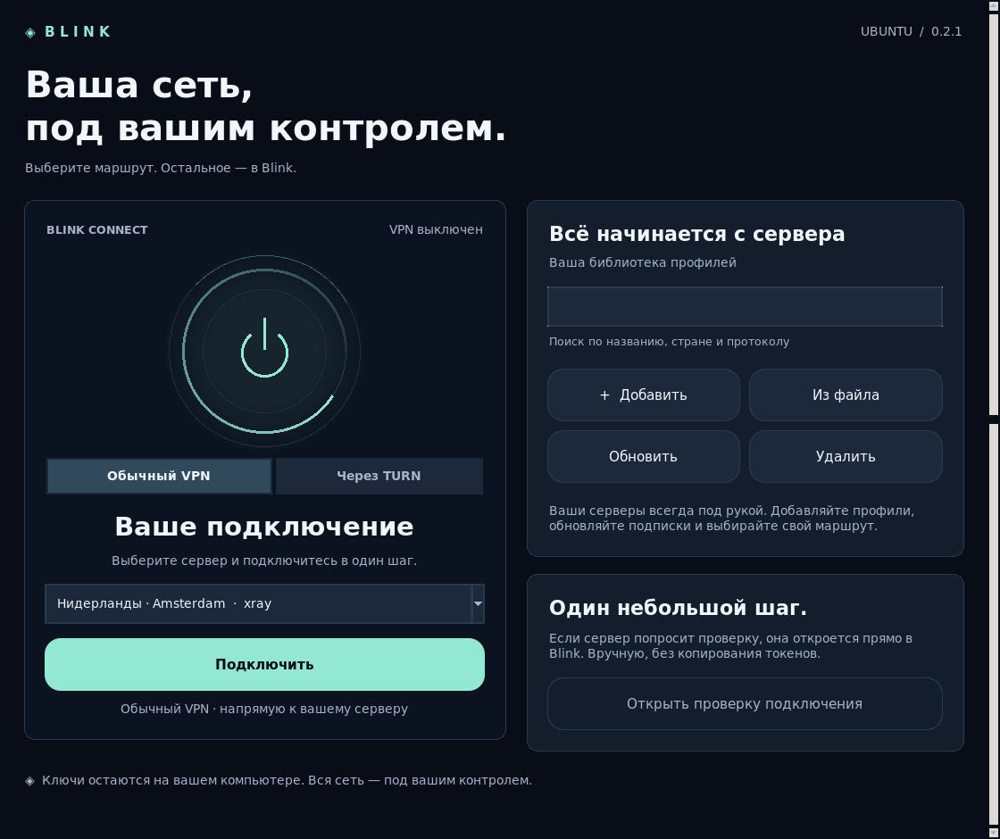
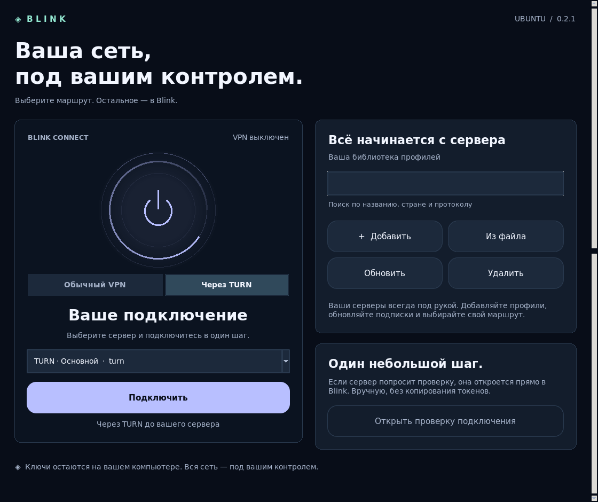
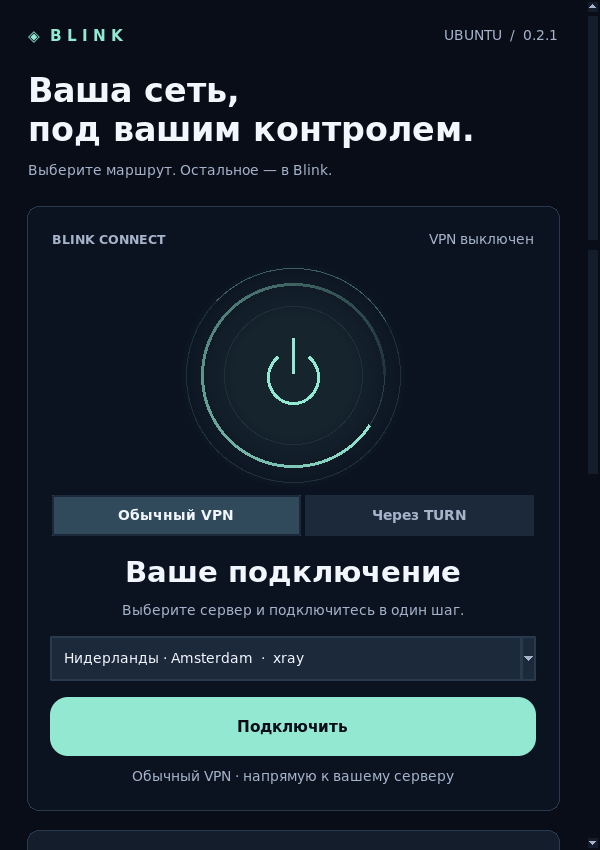

# Blink для Ubuntu

VPN-клиент для **Ubuntu 20.04 и новее** с консольным режимом и графическим интерфейсом. Использует общее Go-ядро [Blink Android](https://github.com/remzone/blink-android) и [Blink iOS](https://github.com/remzone/blink_ios): форматы профилей и транспортный протокол сохранены, вместо мобильного VPN API добавлен Linux TUN.

Версия **0.2.1**. Интерфейс на русском языке. Архитектуры сборки: amd64 и arm64; фактические проверки перечислены в [VALIDATION.md](docs/VALIDATION.md).



<details>
<summary>Режим TURN и узкое окно</summary>





</details>

## Возможности

- CLI и GUI используют одно ядро, хранилище и реализацию подключения.
- Импорт из файла или текста: VLESS, VMess AEAD, Trojan, Shadowsocks/SS2022, SOCKS, HTTP CONNECT, Hysteria2, TUIC v5, legacy Hysteria, WireGuard/AmneziaWG, Xray JSON и узлы Clash/Mihomo YAML.
- Обычные plain/base64 подписки по HTTPS; подписки Vokop v1/v2/v3, срок действия и защита от отката ревизии сохранённой подписки.
- TURN: Auto/TCP/UDP из подписки, DTLS/KCP/smux/VLESS и WireGuard DTLS/SRTP/wrap из общего ядра. Без автоматического перехода на прямое соединение.
- Фирменный интерфейс Blink как в iOS/Android: графитовые карточки, mint/ice акценты, орбита, отдельные режимы VPN/TURN и адаптивные колонки.
- Встроенная ручная CAPTCHA: официальный Web SDK, изображение с полем для кода, автоматическая передача результата и продолжение подключения.
- Маршруты и DNS настраиваются только на время подключения. Локальные маршруты сохраняются; ненастроенный IPv6 блокируется политикой маршрутизации.

## Установка

Готовые сборки **0.2.1** находятся прямо в репозитории:

| Архитектура | Пакет |
| --- | --- |
| Intel / AMD 64-bit | [Скачать .deb для amd64](https://github.com/remzone/blink_ubuntu/raw/refs/heads/main/downloads/v0.2.1/blink-ubuntu_0.2.1_amd64.deb) |
| ARM 64-bit | [Скачать .deb для arm64](https://github.com/remzone/blink_ubuntu/raw/refs/heads/main/downloads/v0.2.1/blink-ubuntu_0.2.1_arm64.deb) |

[Контрольные суммы SHA-256](downloads/v0.2.1/SHA256SUMS). Скачайте пакет для своей архитектуры, затем установите:

```bash
sudo apt install ./blink-ubuntu_0.2.1_amd64.deb
blink gui
```

Для ARM64 используйте пакет `_arm64.deb`. Установка через `apt` подтягивает Python/Tk, GTK3/WebKit, iproute2, Polkit, sudo, CA и resolver.

GUI запускается обычным пользователем, появляется в меню приложений как **Blink**. При подключении Polkit запрашивает пароль администратора для отдельного процесса VPN. CLI запрашивает права через `sudo`. Права для всего графического приложения не нужны.

Требуются рабочие `/dev/net/tun`, `systemd-resolved` и `resolvectl`. На Ubuntu Server включите resolved и убедитесь, что `/etc/resolv.conf` использует его stub resolver; `blink doctor` проверяет наличие инструментов. Изменять DNS всей системы при установке пакет не пытается. Для обычного headless CLI Python/Tk не нужны: достаточно статического `dist/blink`, iproute2, resolved, CA и sudo.

## Консольный режим

```bash
# Файл, содержащий URI, подписку, JSON, YAML или WG/AWG .conf:
blink import --file /path/to/profile.conf

# Вставьте профиль или HTTPS-ссылку, затем Enter и Ctrl+D:
blink import

blink list
blink connect PROFILE_ID
# Ctrl+C отключает VPN и удаляет его настройки.

blink refresh
blink remove PROFILE_ID
blink doctor
```

Секретные ссылки и профили передаются через stdin или файл. Не записывайте действующие токены в аргументы команд, историю shell и отчёты об ошибках. `blink list` выводит только ID, название и тип. `blink export PROFILE_ID` намеренно выводит **секретный** JSON-профиль для резервной копии; храните вывод приватно.

Во время `connect` stdin принимает команды JSON:

```json
{"command":"stop"}
{"command":"captcha","id":"CHALLENGE_ID","kind":"key","value":"HUMAN_ENTERED_CODE"}
```

Событие `captcha` содержит приватные данные проверки, переданные сервером, и срок действия. Для изображения используется `kind=key`, для официального success token — `kind=token`. CAPTCHA решается человеком. На рабочем столе `blink connect` открывает встроенное окно с официальным Web CAPTCHA SDK. Результат передаётся автоматически; в headless-режиме остаётся ручной JSON-протокол. Обычные VPN-профили CAPTCHA не требуют.

## Графический режим

Нажмите «Добавить» и вставьте профиль или HTTPS-подписку, либо «Из файла». Выберите сервер, нажмите «Подключить» и подтвердите системный запрос. «Обновить» обновляет подписки, сохраняя старые профили при ошибке. Поиск фильтрует название, страну в названии и тип протокола. Закрытие окна останавливает соединение.

«Подключено» означает, что ядро запущено и маршруты установлены. Для TURN дополнительно ожидается готовность TURN/DTLS/smux. Это не проверка доступности сайтов или качества конкретного сервера. Для сравнения выхода выполните HTTPS-запрос из другого терминала, например `curl https://www.cloudflare.com/cdn-cgi/trace`, до и во время подключения.

## Сборка из исходников

Нужны **Go 1.27.3**, Python 3 и `dpkg-deb` (пакет dpkg). Go нужен только при сборке; готовый CLI статический и не требует glibc выбранной версии. Зависимости и geodata закреплены в репозитории.

```bash
git clone https://github.com/remzone/blink_ubuntu.git
cd blink_ubuntu
./tools/build.sh
```

Результат в `dist/`: `blink`, `.deb`, `.tar.gz` и SHA-256. Для другой архитектуры:

```bash
GOARCH=arm64 ./tools/build.sh
```

Для запуска GUI из checkout: `./dist/blink gui` (установите `python3-tk` и Polkit). Для CLI: `./dist/blink help`. Встроенное окно CAPTCHA требует GTK3/WebKit; полный `.deb` устанавливает эти зависимости автоматически.

Чтобы все кеши и временные файлы сборки находились в checkout, сначала выполните `source tools/env.sh`. Сам компилятор можно разместить в `work/toolchain/go`; каталог `work/` не публикуется. При использовании env.sh в `work/` создаётся отдельный Go-модуль для изоляции кешей от `go test ./...`.

## Проверки

```bash
./tools/test.sh
# Реальные TUN и ip rule, только в отдельном network namespace:
./tools/test-netns.sh
# Smoke-проверка CLI и окна в Ubuntu 20.04:
docker run --rm -v "$PWD:/project" -e BLINK_UBUNTU_VERSION=20.04 \
  ubuntu:20.04 bash /project/tools/compatibility.sh
```

`test.sh` требует Node.js 18+ для проверки закреплённого SDK и C-компилятор для `-race` и Tk для GUI-тестов. Без DISPLAY проверка создания окна пропускается; в compatibility.sh она выполняется через Xvfb. Go linker flag `-checklinkname=0` необходим закреплённой QUIC/TLS-зависимости ядра и используется скриптами явно.

## Хранение и ограничения

Профили, URL подписок и ключи находятся в `$XDG_CONFIG_HOME/blink/profiles.json` или `~/.config/blink/profiles.json`: каталог `0700`, файл `0600`, атомарная запись и блокировка. **Хранилище не зашифровано**; защищайте учётную запись и диск. В привилегированный процесс профиль передаётся по анонимному pipe, без файлов и секретов в argv. Нет локального веб-сервера или API, доступного другим пользователям.

Это Linux-версия Blink. Нет автозапуска VPN, tray, постоянного kill switch, OpenVPN/AnyConnect/Forti, полного движка правил Clash. Совместный запуск с другим VPN не поддержан. SIGINT/SIGTERM/EOF выполняют откат, но SIGKILL и авария ОС не запускают обработчики: после такого завершения могут остаться правила 10101–10103 и IPv6 route в таблице 51831; порядок восстановления описан в [архитектуре](docs/ARCHITECTURE.md).

Транспорт TURN использует DTLS без аутентификации сертификата удалённого peer, внутренний VLESS — `encryption=none`. Эти свойства мобильного транспорта сохранены; TURN не заменяет сквозную TLS-аутентификацию. Проверка сертификатов HTTPS приложений остаётся независимой.

[CAPTCHA](docs/CAPTCHA.md) · [Оформление](docs/UI-DESIGN.md) · [Архитектура](docs/ARCHITECTURE.md) · [Совместимость](docs/COMPATIBILITY.md) · [Происхождение и лицензии](docs/PROVENANCE.md) · [Результаты проверок](docs/VALIDATION.md)

Лицензия приложения и общего ядра: **GPL-3.0-only**; сторонние лицензии сохранены в `native/`.
