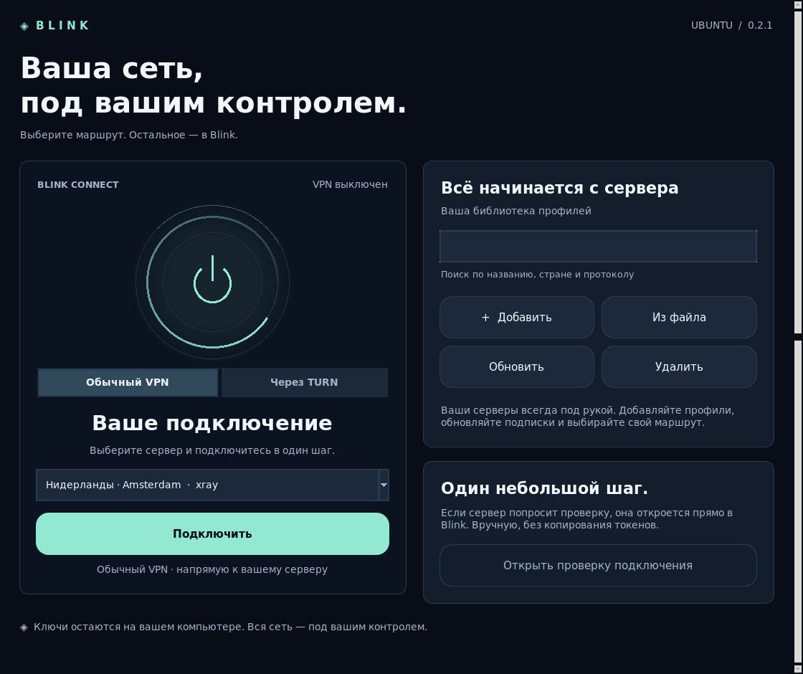

# Оформление Blink для Ubuntu · 0.2.1

Основа — общий визуальный язык Blink iOS и Android: графитовый фон, спокойные поверхности, mint/ice акценты, тонкие границы и округлые карточки. Токены перенесены из `BlinkTheme.swift` / `BlinkStyle.java` и собраны в `gui/theme.py`.

Главный экран повторяет направление мобильного HomeView: заголовок «Ваша сеть, под вашим контролем», большая карточка подключения, орбитальное кольцо и выбор маршрута. Обычный VPN отмечен мятным, TURN — сиреневым. Цвет дублируется текстом. Библиотека и ручная проверка вынесены в соседние карточки.

На широком окне используются две колонки; при ширине менее 960 px — одна. Страница прокручивается, подписи переносятся. Кнопки остаются настоящими ttk-кнопками с клавиатурным фокусом и крупной областью нажатия; декоративная орбита не заменяет доступное текстовое действие «Подключить».

Орбита вращается только во время подключения и только при видимом окне. В простое нет постоянной анимации. GNOME `enable-animations=false` и `BLINK_REDUCE_MOTION=1` отключают вращение. Разные состояния отражают фактический ответ ядра; декоративная индикация не доказывает доступность интернета.

CAPTCHA использует тот же графитовый фон, округлые действия и текст «Один небольшой шаг». Внутреннее задание проверки сохраняет оформление официального SDK. Импорт текста использует общую палитру, кнопки и шрифты.

Проверки: реальные окна Tk и GTK/WebKit под Xvfb, широкая/узкая компоновка, фильтр VPN/TURN, выбор акцента и режим без анимаций. Снимок ниже создан настоящим Ubuntu-клиентом с синтетическими названиями серверов, без ключей.

